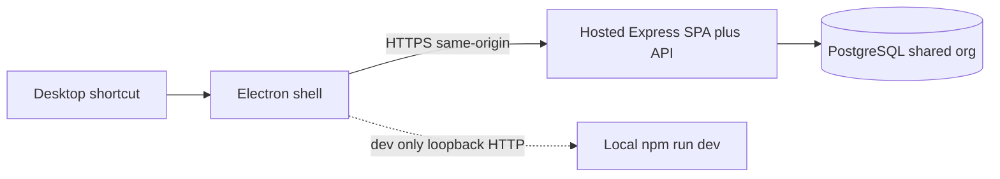

# Phase 7 — Windows Desktop Application (.exe)

**Status:** Electron shell + Windows NSIS installer implemented and verified.  
**Not claimed:** production-ready online use by both owners (cloud hosting is Phase 8).

---

## 1. Existing architecture discovered

| Area | Finding |
| --- | --- |
| Runtime | Express (`server.ts`) + Vite React SPA; `npm run dev` = `tsx server.ts` |
| Production web | `NODE_ENV=production` serves `dist/` statically from the same Express process |
| API | Relative same-origin `/api/*` via `apiFetch` / `fetch` with `credentials: 'include'` |
| Auth | HttpOnly `tl_session` cookie; `SameSite=Lax`; `Secure` when HTTPS / cookie mode |
| Business data | JSON default; PostgreSQL optional via env — **unchanged** |
| Frontend base URL | No separate API host — browser and API share one origin |
| Icons | `public/srsb-mark.svg` only; no prior Electron packaging |

**Implication:** Preserving same-origin hosting avoids CORS and keeps cookie sessions working. Embedding a local Express + DB in the desktop package would risk data duplication and offline writes — rejected for this phase.

---

## 2. Architecture chosen and why

**Thin Electron client** that loads a **configurable hosted application URL** (future HTTPS origin serving the existing SPA + API together).



**Why**

- Reuses the existing UI and auth/cookie model without a second business store.
- Production packaged builds **require HTTPS** and **forbid localhost** — never silently fall back to local server.
- Browser `npm run dev` / `npm run build` remain intact.
- No secrets, DB URLs, or API keys in the desktop package.

**Limitations (by design)**

- Desktop app is unusable for real multi-owner work until Phase 8 hosts the app on HTTPS and `desktop-config.json` / `DESKTOP_APP_URL` is set.
- No automatic updates (no update infrastructure).
- No offline business writes.

---

## 3. Files created and modified

**Created**

- `electron/main.cjs` — main process, secure `BrowserWindow`, navigation guards
- `electron/preload.cjs` — minimal `contextBridge` (setup/offline only)
- `electron/urlConfig.cjs` — URL resolve/validate
- `electron/pages/setup.html` — missing/invalid URL message
- `electron/pages/offline.html` — network failure + retry
- `electron/resources/icon.png` / `icon.ico`
- `desktop-config.example.json`
- `scripts/verify-electron-shell.mjs`
- `tests/unit/urlConfig.test.ts`
- `docs/phase7-desktop-report.md`

**Modified**

- `package.json` — Electron scripts, `main`, electron-builder NSIS config, name/version metadata
- `.gitignore` — `release/`

**Not modified**

- `data/ledger.json`, `data/auth.json`, recovery artifacts
- Backend defaults / `DATABASE_URL` / `AUTH_ORGANIZATION_ID`
- Business auth architecture (beyond consuming the hosted app)

---

## 4. Desktop security configuration

| Setting | Value |
| --- | --- |
| `contextIsolation` | `true` |
| `nodeIntegration` | `false` |
| `sandbox` | `true` |
| `webSecurity` | `true` (not disabled) |
| Insecure Chromium flags | Not used |
| Preload surface | `getShellInfo` / `retryLoad` / `openExternal` only |
| Navigation | Same-origin only; other http(s) → OS default browser |
| `window.open` | Denied; external URLs via `shell.openExternal` |
| Secrets in package | None (no DB/auth keys) |
| Local business DB | None |

---

## 5. How the hosted URL will be configured later

After Phase 8 publishes `https://<your-host>/`:

1. **Preferred:** create `%APPDATA%/ASSOCIATE IT GST Ledger/desktop-config.json`:
   ```json
   { "appUrl": "https://<your-host>" }
   ```
2. **Or** set environment variable `DESKTOP_APP_URL=https://<your-host>`
3. **Or** place `desktop-config.json` beside the installed `.exe`

Example template: `desktop-config.example.json` (and copied into installer `resources`).

**Dev / verification only (unpackaged):**  
`DESKTOP_APP_URL=http://127.0.0.1:3000` while `npm run dev` is running.

Packaged builds reject HTTP and loopback hosts.

---

## 6. Installer output

| Artifact | Path |
| --- | --- |
| NSIS setup | `release/ASSOCIATE-IT-GST-Ledger-Setup-0.7.0-x64.exe` (~111 MB) |
| Unpacked app | `release/win-unpacked/ASSOCIATE IT GST Ledger.exe` |

Installer options: x64, desktop + Start Menu shortcuts, changeable install directory, uninstall support. No auto-update channel.

---

## 7. Build and verification results

| Check | Result |
| --- | --- |
| `npm run build` (browser SPA) | Passed |
| `tests/unit/urlConfig.test.ts` | 7 passed |
| `node scripts/verify-electron-shell.mjs` | Passed (URL guards + mock HTTP + setup launch) |
| Electron secure prefs | Confirmed in `electron/main.cjs` |
| Missing URL → setup page | Confirmed (unpackaged + packaged launch stayed up) |
| Invalid/non-HTTPS packaged URL | Rejected by `urlConfig` |
| Mock loopback HTTP connection | Confirmed via verify script |
| `npm run dist:win` | Passed — installer produced |
| Packaged `.exe` launch | Ran successfully (pid observed), then stopped |

Full prior unit/PG suites were not re-run end-to-end (no business-data code path changes required for this phase). Browser vite build was verified.

---

## 8. Remaining limitations

- Hosted HTTPS backend does not exist yet — owners cannot use the desktop app for shared live data today.
- Code signing uses the local/default signtool path from electron-builder; a production Authenticode certificate was not configured.
- Corporate TLS interception required `NODE_TLS_REJECT_UNAUTHORIZED=0` during Electron binary download on this machine (install-time only; not embedded in the app).
- Icon is a simple generated mark; replace with final brand assets when available.
- Single-instance lock is enabled; second launches focus the existing window.

---

## 9. Confirmation — business data / backend defaults

- Default business backend remains JSON; PostgreSQL path unchanged.
- No connection to production or remote databases from this phase.
- No migrations run.
- `data/ledger.json` / `data/auth.json` not modified.
- No deploy/publish/commit/push performed as part of Phase 7 instructions.

---

## 10. Exact next steps for Phase 8 (cloud hosting)

1. Provision HTTPS hosting for the existing Express app (SPA `dist/` + `/api`) on a public origin.
2. Configure production env: `NODE_ENV=production`, `HOST`, `PORT`, `COOKIE_SECURE=true`, auth/business backends, `AUTH_ORGANIZATION_ID`, encryption keys — **server-side only**.
3. Point PostgreSQL at the shared organization database (not a per-desktop DB).
4. Verify browser login for both owners against the HTTPS origin (cookies Secure + SameSite).
5. Set each desktop client’s `desktop-config.json` / `DESKTOP_APP_URL` to that HTTPS origin.
6. Re-test desktop login/logout, session restore, and shared IT/GST visibility.
7. Optionally Authenticode-sign the NSIS installer before distributing to owners.

**Do not** treat the current desktop build as online-ready until steps 1–6 succeed.
